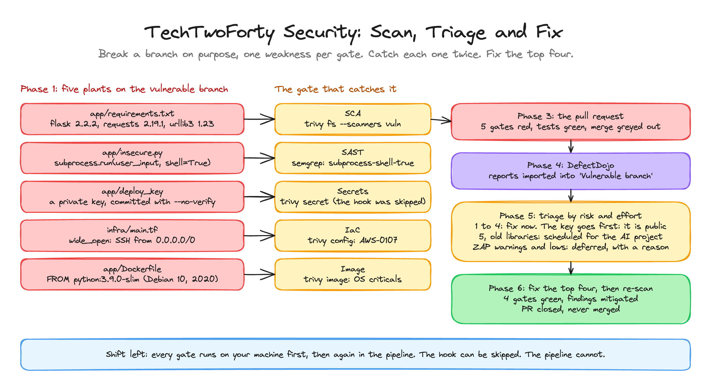

<p align="center">
  
</p>

<h1 align="center">TechTwoForty: Security</h1>
<p align="center"><b>Scan, Triage and Fix, Through the Pipeline</b> · the finished project</p>
<p align="center">
  <a href="https://github.com/wjpearce-github/TechTwoForty-CICD">← Previous: CI/CD</a> ·
  <a href="https://github.com/wjpearce-github/TechTwoForty-Start-Here">Course map</a> ·
  <a href="https://github.com/wjpearce-github/TechTwoForty-AI">Next: AI →</a>
</p>

> [!TIP]
> **This repo is the finished template for the Security project. Treat it as your cheat sheet.**
> It is your `devsecops-capstone` repo's `main` branch at the end of the Security section: every action pinned to a commit SHA, every scanner a gate (ZAP reports), the risk register, the DefectDojo importer and the weekly benchmark. The [`vulnerable`](https://github.com/wjpearce-github/TechTwoForty-Security/commits/vulnerable) branch is here too, with both of its commits: the five plants, then the fix for the top four.

| | |
|---|---|
| **Section** | 8 of 10 · DevSecOps |
| **Time** | About 90 minutes, 6 phases |
| **Runs on** | Every tool from the Security section, your capstone repo, DefectDojo on your VM |
| **Deliverable** | A branch with five planted weaknesses caught twice, a decision for every finding in DefectDojo, four fixes proven by green gates. The branch is never merged |

> [!WARNING]
> **GitHub Actions is switched off on this template repo.** In **your** repo the pipeline and the weekly benchmark run for real.

## The big picture



<sub>Drawn in Excalidraw. To edit it, open <code>assets/diagram.excalidraw</code> at <a href="https://excalidraw.com">excalidraw.com</a>.</sub>

## What is in this repo

```text
devsecops-capstone/                     (this template repo, main branch)
├── .github/workflows/
│   ├── pipeline.yml                    pinned actions, every scanner a gate, !cancelled()
│   └── benchmark.yml                   weekly Prowler CIS benchmark (Security Unit 1)
├── .gitignore                          the Git project's, plus reports/
├── .trivyignore.yaml                   the risk register: AWS-0104 accepted, in main.tf only
├── gates.md                            every check, where it runs, block or report
├── policies/project_tag.yaml           custom Checkov rule: every instance has a Project tag
├── tools/dojo_import.py                sends every report to DefectDojo (Security Unit 8)
├── app/
│   ├── app.py                          security headers + the nosemgrep line (Units 4 and 5)
│   ├── requirements.txt                every version pinned with pip freeze (Unit 3)
│   ├── test_app.py, Dockerfile, docker-compose.yml
├── infra/main.tf                       IMDSv2, encrypted disks, Project tags (Unit 6)
└── reference/
    ├── pre-commit                      your .git/hooks/pre-commit (hooks are never committed)
    └── security-audit-trust.json       the trust policy for the security-audit role
```

Install the hook on your own clone:

```bash
cp reference/pre-commit .git/hooks/pre-commit && chmod +x .git/hooks/pre-commit
```

## Phase 1 · The five plants (on the `vulnerable` branch only)

See them for yourself: [the plant commit and the fix commit](https://github.com/wjpearce-github/TechTwoForty-Security/commits/vulnerable) on this repo's `vulnerable` branch. The key in it is a throwaway made for this template and never used anywhere. The branch is never merged, here or in your repo.

```bash
cd ~/devsecops-capstone && git switch main && git pull && git switch -c vulnerable
```

| Gate | Plant | How |
|---|---|---|
| **SCA** | Old libraries | Replace `app/requirements.txt` with `flask==2.2.2`, `werkzeug==2.2.2`, `requests==2.19.1`, `urllib3==1.23`, `pytest` |
| **SAST** | Shell injection | New `app/insecure.py`: `subprocess.run(user_input, shell=True)` |
| **Secrets** | A private key | `ssh-keygen -t ed25519 -N "" -q -f app/deploy_key && rm app/deploy_key.pub` |
| **IaC** | SSH open to the world | Append a `wide_open` security group to `infra/main.tf`: port 22 from `0.0.0.0/0` |
| **Image** | An old base | Both `FROM` lines to `python:3.9.0-slim` (Debian 10, from 2020) |

```bash
git add -A && git commit -m "Plant one weakness per gate for scanning practice"
# Commit stopped by the pre-commit hook. Your hook doing its job.
git commit --no-verify -m "Plant one weakness per gate for scanning practice"
```

> [!CAUTION]
> `--no-verify` skips every hook. You use it here only to prove the pipeline catches what a skipped hook lets through. With a real key, never.

## Phase 2 · Catch them on your machine (shift left)

```bash
trivy fs --scanners vuln --severity HIGH,CRITICAL app/                         # flask, werkzeug, requests, urllib3
trivy fs --scanners secret app/                                                # app/deploy_key: HIGH, AsymmetricPrivateKey
semgrep scan --config auto app/                                                # insecure.py: subprocess-shell-true
trivy config --severity HIGH,CRITICAL --ignorefile .trivyignore.yaml infra/    # AWS-0107, HIGH
docker build -t myapi:vulnerable app/ && trivy image --severity CRITICAL --ignore-unfixed myapi:vulnerable
```

Egress does not show up in the IaC scan: it is in the risk register. The new SSH rule is a different finding, so the register does not cover it. That is the register working.

## Phase 3 · Push it and open a pull request

```bash
git push -u origin vulnerable
```

Open a PR titled **DO NOT MERGE: scanning practice**.

**You should see:** Run tests green. Secret scan, Dependency scan and SBOM, SAST, IaC scan and Image scan **red**. DAST with ZAP green (reports only). Deploy skipped. Merge button grey. Every gate ran even though the first failed, because of `if: ${{ !cancelled() }}`. Download the `security-reports` artifact.

## Phase 4 · Pull the evidence into DefectDojo

```bash
cd ~/defectdojo && docker compose up -d && cd ~/devsecops-capstone
mkdir -p reports/pr && unzip -o ~/Downloads/security-reports.zip -d reports/pr && rm ~/Downloads/security-reports.zip
read -s -p "DefectDojo API key: " DD_API_KEY && export DD_API_KEY && echo
source .venv/bin/activate && python tools/dojo_import.py reports/pr "Vulnerable branch"
```

The API key is typed, never saved in a file or printed.

## Phase 5 · Triage

| # | Finding | Severity | Effort | Decision |
|---|---|---|---|---|
| 1 | Private key committed to the repo | High | Low | **Fix now** |
| 2 | SSH open to `0.0.0.0/0` | High | Low | **Fix now** |
| 3 | Shell injection in `insecure.py` | High | Low | **Fix now** |
| 4 | Old base image, criticals with fixes | Critical | Low | **Fix now** |
| 5 | Old flask, werkzeug, requests and urllib3 | High | Medium | **Scheduled:** the AI project, with an owner and a date |
| | ZAP warnings and the lows | Low | | **Deferred**, with a written reason |

> [!IMPORTANT]
> The key goes first even though the scanner calls it High, not Critical. It is already on GitHub, where anyone who can read the repo can copy it. Everything else only becomes dangerous once it is deployed.

## Phase 6 · Fix the top four and prove it

```bash
git rm -q app/deploy_key app/insecure.py
# app/Dockerfile: both FROM lines back to python:3.12-slim
# infra/main.tf: delete the wide_open block
trivy config --severity HIGH,CRITICAL --ignorefile .trivyignore.yaml infra/   # nothing HIGH or CRITICAL
git add -A && git commit -m "Fix the top four findings" && git push
```

**You should see:** Secret scan, SAST, IaC and Image scan green. Dependency scan still red, which is a decision you recorded, not a gap. Re-import the new reports: the four findings show as **mitigated**. Then close the PR **without merging**:

```bash
deactivate && unset DD_API_KEY && git switch main
```

> [!CAUTION]
> The deleted key is still in the branch's history on GitHub. With a real key, deleting the file is not the fix. Revoking it and issuing a new one is.

## Final handover check

- [ ] Every gate caught its plant on your machine and in the pull request
- [ ] DefectDojo holds a decision for every finding from the branch
- [ ] Four fixes are proven by green gates and mitigated findings
- [ ] `main` is untouched and the `vulnerable` branch was never merged

## What you can now do

- **Shift left:** every check on your machine first, then the same check in the pipeline
- **Gates:** deliberate block-or-report decisions that hold even when a hook is skipped
- **Evidence:** reports from every scanner in one place, matched across runs
- **Triage:** ranking by risk and effort, with owners, dates and written reasons

The AI project closes item 5.

---

<p align="center">
  <b>TechTwoForty</b> · Security · 8 of 10<br>
  <a href="https://github.com/wjpearce-github/TechTwoForty-CICD">← Previous: CI/CD</a> ·
  <a href="https://github.com/wjpearce-github/TechTwoForty-Start-Here">Course map</a> ·
  <a href="https://github.com/wjpearce-github/TechTwoForty-AI">Next: AI →</a>
</p>
